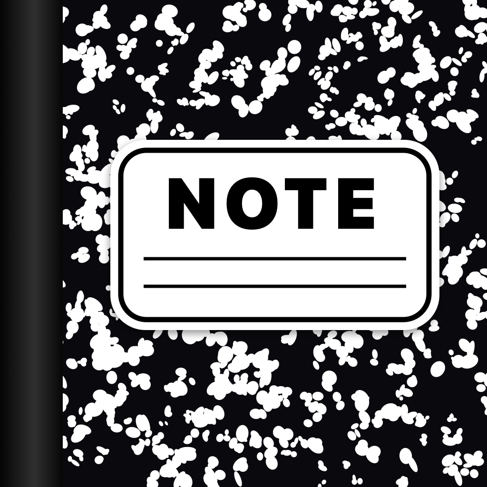
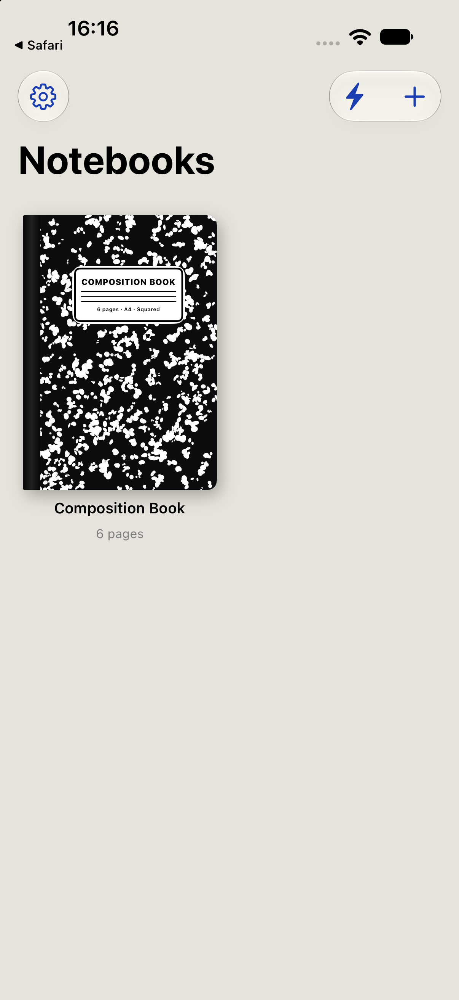

<p align="center">
  
</p>

<h1 align="center">Note</h1>

<p align="center">
  The classic black marble composition notebook, reimagined for iPhone, iPad, iPhone Duo and Apple Watch.
</p>

<p align="center">
  
  
  
  
  
  
  
  <a href="LICENSE"></a>
</p>

<p align="center">
  <a href="https://masterfabric.co">masterfabric.co</a> ·
  Author: <a href="https://github.com/gurkanfikretgunak">Gürkan Fikret Günak</a> ·
  <code>com.masterfabric.note</code>
</p>

<p align="center">
  
</p>

## Features

**Notebooks**

- Classic black marble cover with a black spine and a white label. Choose from 7 colors, 4 abstract patterns (marble, waves, rings, mosaic), or a photo from your library.
- Six A4 paper styles: squared (5 mm), lined, guide lines, dotted, geometric, and blank. Paper fills the whole screen edge to edge.
- Page turns: 3D page curl or 2D slide.
- Reading mode, light and dark themes, and a warm reading paper option.

**Writing and drawing**

- Draw with Apple Pencil or your finger, powered by PencilKit. An optional "Apple Pencil only" mode lets your finger turn pages.
- Type text directly onto a page.
- Stickers and objects: white-edged stickers, handy labels (TO DO, IMPORTANT, IDEA, today's date, and more), sticky notes, washi tape, five styles of text boxes, and shapes. Lift an item to move it, press it back onto the paper with haptic feedback, and resize or rotate it with the corner handle.

**Quick actions and sharing**

- Share a page as an image, or a whole notebook as a PDF.
- Send a page to an AI agent: the page image, recognized handwriting, and a ready-made prompt (summarize, turn into a to-do list, clean up notes) go into the share sheet.
- Home screen shortcuts, Siri and Shortcuts actions, and URL links: `mfnote://quick`, `mfnote://new`, `mfnote://continue`.
- Home screen and Lock Screen widgets.

**Apple Watch**

- Notebook list, recent notes, and quick notes from your wrist. Notes you add on the watch land in the Quick Notes notebook on your iPhone.

## iPhone Duo

Note uses the iOS 27.1 hinge API (`onHingeChange`) on foldable devices:

- **Folded shut:** the cover of the notebook you were using fills the screen, in its own color, pattern, or photo. Below it are *Open*, *Quick Note*, and *Change Cover* buttons.
- **Opening:** the cover swings open around its spine, following the hinge angle, and reveals the page.
- **Open:** the sheet covers the full wide screen and drawing works across all of it.
- You can turn this off in Settings with *Show cover when folded*.

## Technology

| Layer | Used for |
| --- | --- |
| UI | SwiftUI, Observation (`@Observable`) |
| Drawing | PencilKit (`PKCanvasView`, `PKToolPicker`) |
| Page turning | `UIPageViewController` (page curl and scroll) |
| Handwriting recognition | Vision (`VNRecognizeTextRequest`), on device |
| Shortcuts | App Intents, `UIApplicationShortcutItem`, URL scheme |
| Widgets | WidgetKit, data shared through an App Group |
| Watch | WatchConnectivity |
| Foldables | SwiftUI `onHingeChange` / `DeviceHinge` |
| Project | XcodeGen (`project.yml`) |
| Language | English (source) |

There are no third-party dependencies. Data stays on the device: a `library.json` file plus one PencilKit drawing file per page.

## Project structure

```
Note/          iOS app (iPhone, iPad, Duo)
  Views/       Library, cover, paper, page, stickers, settings, hinge cover
  Tools/       Export, handwriting recognition, App Intents, watch and widget bridge
NoteWatch/     watchOS app
NoteWidget/    Home screen and Lock Screen widget
Shared/        Shared models and the string catalog
scripts/       App icon generator
```

## Getting started

Requirements: Xcode 27 and [XcodeGen](https://github.com/yonaskolb/XcodeGen).

```bash
xcodegen generate
```

```bash
open Note.xcodeproj
```

For a real device, choose your signing team in Xcode and enable the `group.com.masterfabric.note` App Group. The widget reads its data through that group.

To regenerate the app icon:

```bash
swift scripts/make-icon.swift docs/app-icon.png
```

## Status

- Tested on the iPhone and iPhone Duo simulators.
- The Apple Watch app and the widget build, but have not yet been run on a device or simulator.
- The app is in English only.

## License

This project is licensed under the [GNU Affero General Public License v3.0](LICENSE) (AGPL-3.0), the same license as MasterFabric's [osmea](https://github.com/masterfabric-mobile/osmea) project. If you modify the software and offer it to users over a network, you must make your modified source available under the same license.

## Author

**Gürkan Fikret Günak** — [MasterFabric](https://masterfabric.co) · [@gurkanfikretgunak](https://github.com/gurkanfikretgunak)
